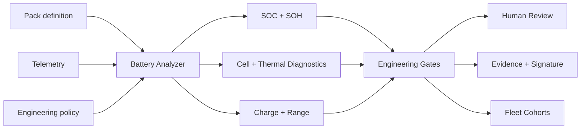

# BatteryIQ Lab

An explainable EV battery-intelligence and engineering-evidence workbench. It analyzes pack telemetry for SOC estimation, SOH indicators, cell imbalance, thermal behavior, charging quality, energy consumption, estimated range and fleet cohorts.

> The included data is synthetic. BatteryIQ does not control a BMS, certify a battery, predict safety with certainty, or replace qualified engineering judgment.

## Implemented

- versioned pack identity, chemistry, nominal capacity/energy and cell count
- bounded, ordered pack/cell/temperature telemetry validation
- coulomb-counting SOC estimate and reported-SOC error
- usable-capacity estimate and capacity-based SOH
- current-step internal-resistance estimate and resistance-based SOH
- combined explainable SOH indicator
- per-sample cell-voltage spread, P95 and worst imbalance status
- maximum temperature, temperature spread and rise-rate analysis
- cell-voltage, over-temperature and over-current findings
- charging duration, energy, SOC gain and mean-power quality
- drive energy, consumption and SOH-adjusted range estimate
- explicit engineering gates with `eligible-for-human-review` or `investigation-required`
- baseline/candidate comparison and fleet chemistry cohorts
- SHA-256 evidence integrity and optional RSA-SHA256 signatures
- bounded loopback REST API, optional bearer authentication and browser console
- synthetic drive/charge-cycle demonstration
- **36 dependency-free runtime tests**

## Quick start

Requires Node.js 20 or later.

```bash
npm test
npm run demo
npm start
```

Open <http://127.0.0.1:8082>. Set `API_TOKEN` from a secret manager to require bearer authentication. Never commit credentials or production battery data.

## API

| Method | Path | Purpose |
|---|---|---|
| GET | `/api/health` | Runtime health |
| GET | `/api/example` | Synthetic pack, telemetry and policy |
| POST | `/api/analyses` | Analyze one pack campaign |
| GET | `/api/analyses/{id}` | Retrieve report |
| GET | `/api/analyses/{id}/evidence` | Retrieve evidence envelope |
| POST | `/api/evidence/verify` | Detect evidence tampering |
| POST | `/api/fleet` | Aggregate retained pack reports |
| POST | `/api/compare` | Compare two retained reports |

Bodies are limited to **5,000,000 bytes**, telemetry to **100,000 samples**, cells to **10,000**, and retained runs to **100**.

## Architecture



The domain layer has no cloud, database, ML framework or vehicle-network dependency. Telemetry ingestion and storage belong behind adapters. See [architecture](docs/architecture.md), [method limitations](docs/methods-and-limitations.md), and [threat model](docs/threat-model.md).

## Interpretation

SOH values are engineering indicators derived from available discharge-window and current-step data. They are not laboratory capacity tests. Range depends on the observed drive segment and must not be represented as guaranteed vehicle range. Gate success only means `eligible-for-human-review`.

## Honest roadmap

CAN/UDS and SmartVehicle ingestion, VSS mapping, durable time-series storage, electrochemical/EKF estimators, cycle counting, rainflow analysis, richer degradation models, ML anomaly detection, charging-protocol integration, cloud fleet analytics, HIL, OIDC and tenant isolation are not yet implemented.

## Security, safety and licensing

The service binds to loopback, emits restrictive browser headers, validates bounded inputs and supports bearer authentication. It has no actuator or BMS-write interface. See [SECURITY.md](SECURITY.md).

This version is proprietary and source-available. Production, commercial, customer, vehicle, embedded-system or field use requires a separate written commercial license. See [LICENSE](LICENSE) or contact `nagaraj.rbhagwat@expleogroup.com` or an authorized Expleo Group representative. The initial historical EPL-2.0 commit retains its prior grant.
